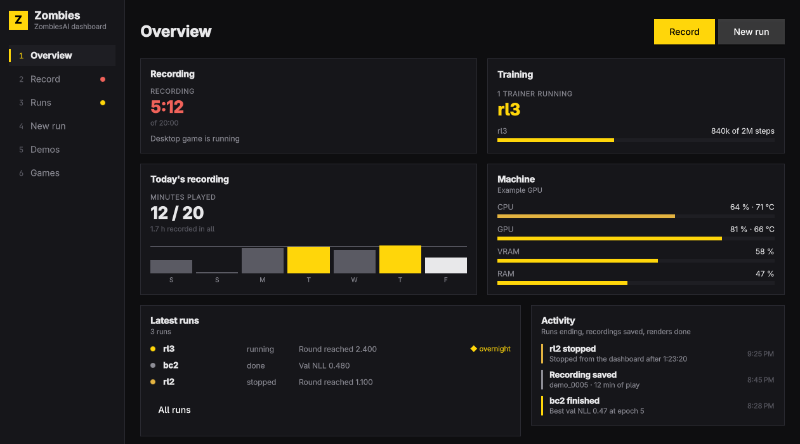

# Zombies



The ZombiesAI dashboard for Omarchy. It records demos on the fleet's game, starts and stops training runs
with any of their settings, trains behavioural cloning from the demos you pick, and shows how it all is
going. It is a native Qt Quick app that follows the Omarchy theme and rounding live and is driven from the
keyboard.

| Page | What it does |
|---|---|
| **Overview** | The recording, the running trainers, today's minutes against the 20-minute goal, the machine (CPU, GPU, VRAM, RAM), the latest runs and what just happened. |
| **Record** | Starts and stops a recording (`scripts/record_lan.sh`): minutes, notes, gamepad, live overlay, game audio. Shows the live state (waiting, countdown, REC, NOT PLAYING, capture lost) and the recorder's output, and starts or quits the desktop game. |
| **Runs** | Every run, newest first. The selected run's curves, progress, time left, notes and trainer output, with Stop (as Ctrl-C: keys released, checkpoint written) and Force stop 30 s later. |
| **New run** | An RL run on the fleet (`scripts/train_rl.py`) or BC from demos (`scripts/train_bc.py`). Every trainer setting is read from the trainer itself, grouped and searchable, and only the ones you change become flags. The run length is estimated from the last run's speed, and the form warns about a busy or short fleet. **Presets** save and reload a set of settings, and a run started from one is marked with it. |
| **Demos** | Every session: play minutes, F8 marks, scene, audio, gamepad, capture problems and size. Renders and plays the input video (`scripts/render_inputs.py`). Today's goal, the week and the total. |
| **Games** | Starts and stops the fleet, shows live thumbnails of each instance, and opens or closes the viewer windows. Also controls the desktop game. |

When a run ends (finished, stopped or crashed), a recording is saved, or a render or BC run finishes, it
appears under Activity and as a desktop notification. Notifications keep coming with the window closed, as
long as the server runs.

## How it works

Everything the app shows and does goes through the Training Room server (`scripts/supervise.py`, on
`127.0.0.1:8765`). The browser page (Super+Shift+Z) uses the same server, so the two never disagree.
`src/zombiesai/viz/control.py` documents every endpoint. If the server isn't running, the app starts it the
way Super+Shift+Z does (`~/.local/bin/zombiesai-dashboard --no-open`), detached, so runs and the server
outlive the window. Closing the app never stops a run or a recording.

`ZOMBIESAI_DASHBOARD_URL` points it at another server, for example a worktree's on another port.
`ZOMBIESAI_REPO` names the checkout to start the server from when `zombiesai-dashboard` isn't installed.

## Shortcuts

| Key | Action |
|---|---|
| `1` – `6` | Overview, Record, Runs, New run, Demos, Games |
| `Space` | The page's main action: start or stop recording on Record, start the run on New run |
| `Ctrl+R` | Refresh everything now |
| `Ctrl+B` | Open the Training Room in the browser |
| `?` | Show every shortcut |
| `Esc` | Close the shortcut list |
| `Q` / `Ctrl+Q` | Quit (runs and recordings keep going) |

Single-key shortcuts are off while a text field has the keyboard.

## Build

```sh
app/bin/build      # build/zombies
app/bin/test       # the Qt tests, offscreen
app/bin/install    # makepkg -fsi: installs it, with its icon and launcher entry (Super+Space)
```

It needs `qmake6`, `make`, a C++ compiler and Qt 6's base, declarative and Wayland modules, all of which
Omarchy ships.
